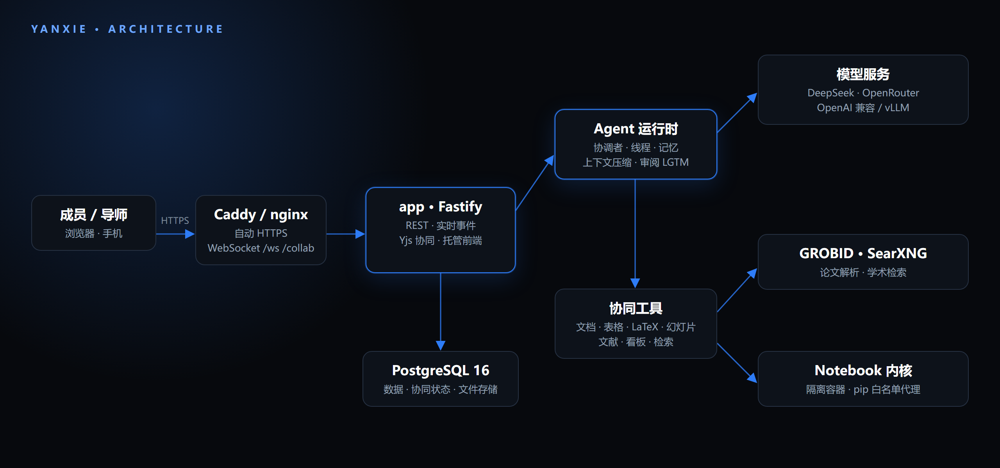

<p align="center">
  
</p>

<p align="center">
  <a href="https://co.thinkloft.io"><b>在线体验</b></a> ·
  <a href="#-部署到你的服务器"><b>部署</b></a> ·
  <a href="#-功能一览"><b>功能</b></a> ·
  <a href="#-架构"><b>架构</b></a> ·
  <a href="ARCHITECTURE.md"><b>文档</b></a> ·
  <a href="#english">English</a>
</p>

<p align="center">
  <a href="LICENSE"></a>
  
  
  
  
  
</p>

---

**研协**是一个面向科研团队的多人协同 AI Agent 平台。现在的 AI 助手大多是「一人一个对话框」，研协换了一个思路：**一个课题配一个共享的协调者 Agent**。成员把需求发到协作台，协调者把需求拆成若干线程，交给线程 Agent 并行推进。成员、导师和 Agent 在同一份上下文里工作，读写的是同一批文档、表格、LaTeX 论文、幻灯片、文献和看板。Agent 的每一步思路和工具调用都有记录，导师随时能看，并在关键节点审阅、点 LGTM 放行。

研协是开源的，可以部署在课题组自己的服务器上，消息、文档和研究数据都留在你们自己的数据库里。

> [!TIP]
> 不想自己部署，可以先在 **[co.thinkloft.io](https://co.thinkloft.io)** 注册体验，这是我们维护的官方实例。

<p align="center">
  
</p>

## ✦ 为什么是研协

|          | 一般的 AI 助手     | 研协                                  |
| -------- | ------------------ | ------------------------------------- |
| 使用单位 | 一个人、一个对话框 | 一个课题、一个团队                    |
| 任务方式 | 一问一答，串行     | 协调者拆成线程，多个 Agent 并行       |
| 上下文   | 每次都要重新交代   | 课题方案、团队依据、个人记忆持续积累  |
| 过程可见 | 只看到结果         | 思路、工具调用、改动全程留痕          |
| 质量把关 | 自己判断           | 导师在关键节点审阅、LGTM              |
| 产出     | 复制粘贴到别处     | 直接写进协同文档、表格、LaTeX、幻灯片 |
| 数据     | 存在服务商         | 自托管，数据在自己的服务器            |

## ✦ 功能一览

<table>
<tr>
<td width="50%" valign="top">

**🧭 协调者与并行线程**<br>
一个课题共用一个协调者。它理解需求、拆分任务、派给线程 Agent 并行执行，在协作台汇总进展。

**👤 我的工作区**<br>
每人有私有会话和个人空间。想法成熟后一键转给协调者，或通过链接分享给同事。

**✅ 审阅与 LGTM**<br>
导师查看协调者的思路、研究空间和 Agent 的改动，在关键节点审阅放行。

**📐 正式方案与团队依据**<br>
课题方案有版本和差异对比，修改需提案审批；团队依据和个人记忆让 Agent 越用越懂课题。

</td>
<td width="50%" valign="top">

**✍️ 多人实时协同**<br>
文档、LaTeX 论文、表格、幻灯片支持多人同时编辑（Yjs），能看到彼此的光标；AI 能直接写进去。

**📚 文献库与论文解析**<br>
导入 PDF，用 GROBID 解析版面，支持标注、笔记和基于论文的问答。

**🔬 研究空间与 Notebook**<br>
在隔离容器里运行 Python Notebook，过程和证据都留在课题里。

**📊 组会汇报 · 看板 · 联网检索**<br>
从课题上下文直接生成组会汇报；看板和待办管理进度；自托管 SearXNG 加 Crossref、OpenAlex、arXiv 学术检索。

**🖥️ 混合 AI（本地 Intel + 云端）**<br>
润色、翻译、总结等轻任务交给本机 Intel 核显上的小模型，复杂推理走云端；发往云端前先脱敏，本地不可用时自动回退云端。

**📄 保版式 PDF 翻译**<br>
整篇论文翻译成中文，保留原排版、公式和图表，输出仅译文和双语对照两种 PDF。

</td>
</tr>
</table>

<p align="center">
  
  
</p>
<p align="center">
  
  
  
</p>

还有：**多模型**（默认 DeepSeek，可选 OpenRouter 或任意 OpenAI 兼容服务）· **中英文界面** · **手机端适配**与亮/暗主题 · **API 令牌与 MCP 接入**（让外部 Agent 读写课题，默认关）· **群机器人通知**（默认关）· **按量计费**（默认关）。

## ✦ 部署到你的服务器

研协是一个可以自托管的 Web 应用。正式使用时，把它部署到一台 Linux 服务器上，绑定你自己的域名，团队成员通过 `https://你的域名` 访问。

**准备：**

- 一台 Ubuntu / Debian 服务器，建议 4 核 8 GB 内存以上（论文解析服务 GROBID 空闲时约占 3 GB）
- 一个域名，把 A 记录指向服务器
- 一个模型服务的 API Key，默认是 [DeepSeek](https://platform.deepseek.com)

**三步上线：**

```bash
# 1. 以 root 登录服务器，下载初始化脚本
curl -fsSLO https://raw.githubusercontent.com/likangxian1007/yanxie/main/deploy/bootstrap-server.sh

# 2. 初始化：安装 Docker、配置反向代理和防火墙、克隆仓库、生成带随机密钥的 .env
DOMAIN=lab.example.com bash bootstrap-server.sh

# 3. 填上模型 Key，然后部署
nano /opt/yanxie/.env        # LLM_API_KEY=sk-...；ADMIN_EMAILS=你的邮箱
bash /opt/yanxie/tools/deploy/deploy.sh
```

部署完成后打开 `https://lab.example.com` 注册即可。Caddy 会自动申请并续期 HTTPS 证书。之后更新版本只需要再跑一次 `deploy.sh`，它会先备份数据库，再构建、启动并做健康检查；每天 03:30 还会自动备份数据库和上传文件。

<details>
<summary><b>部署时会启动哪些服务</b></summary>

| 服务                           | 作用                                                        |
| ------------------------------ | ----------------------------------------------------------- |
| `app`                          | Node 后端，同时托管前端；只监听 `127.0.0.1`，由反向代理对外 |
| `db`                           | PostgreSQL 16                                               |
| `grobid`                       | 论文版面解析                                                |
| `searxng`                      | 自托管元搜索，供 Agent 联网检索                             |
| `pypi-proxy` / Docker API 代理 | Notebook 内核装包与容器隔离                                 |
| Caddy（或已有的 nginx）        | HTTPS 与 WebSocket（`/ws`、`/collab`）反向代理              |

</details>

<details>
<summary><b>已有 nginx、想挂在子路径、端口被占用？</b></summary>

- 机器上已经在跑 nginx 时，脚本会新增一个独立站点，不改动别的站点；这种情况下 HTTPS 需要你用 certbot 或 Cloudflare 自己配。
- 想把平台放在 `https://域名/app/` 下，设置 `WEB_BASE_PATH=/app/`。
- 端口冲突时用 `PUBLIC_PORT=8088 APP_PORT=18787` 换端口。
- 不需要 Notebook 时，在 `.env` 里设 `KERNEL_MODE=none`。

备份恢复、GROBID 内存调优、API 令牌与 MCP、群通知等完整说明见 **[deploy/README.md](deploy/README.md)**。

</details>

<details>
<summary><b>不用脚本，直接用 Docker Compose</b></summary>

```bash
git clone https://github.com/likangxian1007/yanxie.git && cd yanxie
cp .env.example .env
# 编辑 .env：POSTGRES_PASSWORD、SESSION_SECRET（openssl rand -hex 32）、LLM_API_KEY、PUBLIC_URL=https://你的域名
docker build -t srh-kernel:latest deploy/kernel     # Notebook 内核镜像；不需要 Notebook 就设 KERNEL_MODE=none
docker compose --env-file .env up -d --build
```

应用监听 `127.0.0.1:${APP_PORT:-8787}`，请在前面加上你自己的 HTTPS 反向代理。

</details>

## ✦ 本地 Intel 混合 AI（可选）

研协可以把一部分 AI 任务放到你自己电脑上的小模型里跑，其余交给云端。不配置时一切照常走云端。

- **本地模型**：在 Intel Core Ultra 的 Arc 核显上用 [OpenVINO Model Server](https://github.com/openvinotoolkit/model_server)（OVMS）运行 **Qwen3-4B**（int4），在 Core Ultra 9 386H 上实测约 **25 tok/s**。也兼容 Ollama、LM Studio 等任意 OpenAI 兼容端点。
- **分流**：润色、翻译、总结、上下文压缩、隐私脱敏和整篇 PDF 翻译走本地；复杂推理（Agent、续写、生成）走云端 DeepSeek。可用 `HYBRID_ROUTES` 按任务改成 `local` / `cloud` / `auto`。
- **隐私护栏**：发往云端前，在本地把人名、数值、邮箱等换成占位符；结果回来后在本地还原。
- **自动回退**：本地模型没开、超时、出错或输入太长时，自动改走云端，用户无感。
- **混合看板**：侧边栏「混合 AI」页面显示本地/云端调用次数、本地速度和延迟、每次调用走了哪一侧。

**最低配置**：带 Arc 核显的 Intel Core Ultra 处理器，16 GB 以上内存（推荐 32 GB），约 10 GB 磁盘空间。没有 Intel 设备或没装本地模型时，所有任务自动使用云端。

```bash
# 启动本地模型（OVMS，Intel 核显）
ovms --rest_port 8000 --source_model OpenVINO/Qwen3-4B-int4-ov --model_name qwen3-4b --target_device GPU
# .env
LOCAL_LLM_BASE_URL=http://127.0.0.1:8000/v3
LOCAL_LLM_MODEL=qwen3-4b
```

保版式 PDF 翻译是一个可选的独立服务，见 [tools/pdf-translate](tools/pdf-translate/README.md)。它使用 AGPL-3.0 的 [pdf2zh-next](https://github.com/PDFMathTranslate/PDFMathTranslate-next)，作为依赖单独安装、单独运行，不随本仓库分发。

> 一键安装脚本（自动装好 OVMS、下载模型并写入配置）**即将提供**。

## ✦ 本地开发与试跑

如果只是想在自己电脑上看看效果或参与开发，可以不用 Docker 和 Postgres（默认使用嵌入式 PGlite）。需要 Node ≥ 22.12 和 pnpm 11（`corepack enable`）。

```bash
pnpm install
cp .env.example .env     # 至少填 LLM_API_KEY；不填也能启动，只是 Agent 不回复
pnpm dev                 # 后端 :8787，前端 :5173
```

然后打开 `http://localhost:5173`。这个地址只在你自己的电脑上能访问，用于开发调试；给团队使用请按上一节部署到服务器。提交代码前请运行 `pnpm check`。

## ✦ 架构

<p align="center"></p>

| 目录              | 内容                                                                |
| ----------------- | ------------------------------------------------------------------- |
| `apps/server`     | Fastify 后端：REST / WebSocket / Yjs 协同、Agent 运行时、数据库迁移 |
| `apps/web`        | React + Vite 前端                                                   |
| `apps/landing`    | 产品介绍页                                                          |
| `packages/shared` | 前后端共享的类型、zod schema 与 i18n 工具                           |
| `deploy/`         | 自托管部署脚本、内核镜像、SearXNG / GROBID 配置                     |
| `docs/`           | 设计与调研文档                                                      |

## ✦ 配置

所有配置都在 `.env`，完整列表和说明见 [.env.example](.env.example)。最常用的几项：

| 变量                                     | 说明                                                                |
| ---------------------------------------- | ------------------------------------------------------------------- |
| `DOMAIN`                                 | 服务器部署的域名，设了就自动签发 HTTPS                              |
| `PUBLIC_URL`                             | 对外访问地址，如 `https://lab.example.com`                          |
| `LLM_API_KEY` / `LLM_BASE_URL`           | 默认模型服务（DeepSeek，或任意 OpenAI 兼容地址）                    |
| `OPENROUTER_API_KEY`                     | 可选，启用 OpenRouter 上的更多模型                                  |
| `ADMIN_EMAILS`                           | 管理员邮箱（逗号分隔）；第一个注册的用户不会自动成为管理员          |
| `SESSION_SECRET`                         | 会话签名密钥，32 位以上随机串（初始化脚本会自动生成）               |
| `KERNEL_MODE`                            | Notebook 内核：`none` / `gateway` / `docker`                        |
| `SMTP_*` / `MAIL_FROM`                   | 找回密码邮件；不配则只把链接写进日志                                |
| `API_TOKENS_ENABLED` / `MCP_ENABLED`     | API 令牌与 MCP 接入（默认关）                                       |
| `BILLING_ENABLED`                        | 按量计费（默认关）                                                  |
| `LOCAL_LLM_BASE_URL` / `LOCAL_LLM_MODEL` | 可选，本机模型（如 OVMS + Qwen3-4B）；都留空 = 全部走云端           |
| `PDF_TRANSLATE_URL`                      | 可选，保版式 PDF 翻译服务地址（tools/pdf-translate）；留空 = 不启用 |

## ✦ 文档

- [ARCHITECTURE.md](ARCHITECTURE.md)：架构、模块归属、一致性设计
- [API.md](API.md)：REST / WebSocket / 事件契约
- [deploy/README.md](deploy/README.md)：自托管部署、备份恢复、接入与通知
- [CONTRIBUTING.md](CONTRIBUTING.md)：贡献指南（fork + PR、`pnpm check`、i18n）
- [STYLE.md](STYLE.md)：界面规范
- [AGENTS.md](AGENTS.md)：给 AI Agent 的开发守则

## ✦ 参与贡献

欢迎提 Issue 和 Pull Request。开始前请读 [CONTRIBUTING.md](CONTRIBUTING.md)，提交前在本地跑通 `pnpm check`。

## English

<p align="center">
  <a href="https://co.thinkloft.io"><b>Live demo</b></a> ·
  <a href="#deploy-on-your-own-server"><b>Deploy</b></a> ·
  <a href="#features"><b>Features</b></a> ·
  <a href="#architecture"><b>Architecture</b></a> ·
  <a href="ARCHITECTURE.md"><b>Docs</b></a>
</p>

**Yanxie (研协, "research together")** is an open-source, self-hostable, multi-user AI agent platform built for research teams.

Most AI assistants today are _one person, one chat box_. Yanxie takes a different approach: **every research project shares one coordinator agent**. Members post requests to the project desk. The coordinator breaks each request into **threads** and hands them to worker agents that run in parallel. Students, advisors and agents all work in the same context and on the same documents, spreadsheets, LaTeX papers, slides, papers and kanban boards. Every step an agent takes, from its reasoning to its tool calls and edits, is recorded. Advisors can follow along at any time and approve key milestones with a review / LGTM.

You can run Yanxie on your own lab server, so messages, documents and research data stay in your own database.

> [!TIP]
> Want to try it before deploying? Sign up on **[co.thinkloft.io](https://co.thinkloft.io)**, the official instance we run.

### Why Yanxie

|               | Typical AI assistant                  | Yanxie                                                           |
| ------------- | ------------------------------------- | ---------------------------------------------------------------- |
| Unit of use   | One person, one chat                  | One project, one team                                            |
| How work runs | One question, one answer, in sequence | Coordinator splits work into threads; agents run in parallel     |
| Context       | Re-explained every time               | Project plan, team knowledge base and personal memory accumulate |
| Visibility    | Only the final answer                 | Reasoning, tool calls and edits are fully traceable              |
| Quality gate  | You judge it yourself                 | Advisor reviews and LGTMs key milestones                         |
| Output        | Copy-paste somewhere else             | Written straight into shared docs, sheets, LaTeX and slides      |
| Data          | Stored by the vendor                  | Self-hosted on your own server                                   |

### Features

- **Coordinator and parallel threads.** One coordinator per project understands requests, splits them into tasks, dispatches worker agents and summarizes progress on the project desk. Agents _claim_ a resource before editing it, so conflicts are flagged before they happen.
- **My workspace.** Each member has private sessions and a personal space. When an idea is ready, hand it to the coordinator in one click, or share it with a teammate by link.
- **Review and LGTM.** Advisors inspect the coordinator's reasoning, the research space and every agent change, then approve at key checkpoints. Nothing important ships without a human in the loop.
- **Official plan and team knowledge base.** The project plan is versioned with diffs, and changes go through proposals and approval. Team knowledge and personal memory make agents understand the project better over time.
- **Real-time collaboration.** Rich-text docs, LaTeX papers (source / split / preview), spreadsheets with formulas and slides support simultaneous editing with live cursors (Yjs CRDT). The AI writes directly into them.
- **Paper library.** Import PDFs, parse layout and references with GROBID, annotate, take notes and ask questions grounded in the paper.
- **Research space and notebooks.** Run Python notebooks in isolated containers with resource limits and an allow-listed package proxy, so the process and evidence stay in the project.
- **Group-meeting reports, kanban and web search.** Draft meeting reports from the project's context; track work on kanban boards and to-do lists; search the web through a self-hosted SearXNG plus Crossref, OpenAlex and arXiv.
- **Hybrid AI (local Intel + cloud).** Light tasks such as polishing, translation and summarization run on a small model on your Intel iGPU, while complex reasoning goes to the cloud. Content is redacted before it leaves the machine, and calls fall back to the cloud automatically when the local model is unavailable.
- **Layout-preserving PDF translation.** Translate a whole paper into Chinese while keeping the original layout, formulas and figures, as a translation-only PDF and a bilingual side-by-side PDF.
- **Also included:** multiple models (DeepSeek by default; OpenRouter or any OpenAI-compatible endpoint, including self-hosted vLLM) · Chinese and English UI · mobile layout with light and dark themes · API tokens and MCP so external agents can read and write the project (off by default) · group-chat bot notifications (off by default) · usage-based billing (off by default).

### Deploy on your own server

Yanxie is a self-hostable web app. For real use, deploy it on a Linux server, point your own domain at it, and your team opens `https://your-domain`.

**You need:** an Ubuntu / Debian server (4 vCPU and 8 GB RAM or more recommended; GROBID alone uses about 3 GB when idle), a domain whose A record points to the server, and an API key for a model provider ([DeepSeek](https://platform.deepseek.com) by default).

```bash
# 1. As root on the server, download the bootstrap script
curl -fsSLO https://raw.githubusercontent.com/likangxian1007/yanxie/main/deploy/bootstrap-server.sh

# 2. Install Docker, set up the reverse proxy and firewall, clone the repo,
#    and generate an .env with random secrets
DOMAIN=lab.example.com bash bootstrap-server.sh

# 3. Add your model key, then deploy
nano /opt/yanxie/.env        # LLM_API_KEY=sk-...   ADMIN_EMAILS=you@example.com
bash /opt/yanxie/tools/deploy/deploy.sh
```

Open `https://lab.example.com` and sign up. Caddy obtains and renews the HTTPS certificate automatically. To update later, run `deploy.sh` again: it backs up the database, rebuilds, restarts and health-checks. The database and uploads are also backed up every day at 03:30.

- Already running nginx? The script adds a separate site and leaves your other sites alone; set up HTTPS yourself with certbot or Cloudflare in that case.
- Serve under a sub-path such as `https://domain/app/` with `WEB_BASE_PATH=/app/`.
- Port conflict? Use `PUBLIC_PORT=8088 APP_PORT=18787`.
- No need for notebooks? Set `KERNEL_MODE=none`.
- Prefer plain Docker Compose: `cp .env.example .env`, fill in `POSTGRES_PASSWORD`, `SESSION_SECRET`, `LLM_API_KEY` and `PUBLIC_URL`, then `docker compose --env-file .env up -d --build` and put your own HTTPS reverse proxy in front of `127.0.0.1:8787`.

Backups and restore, GROBID memory tuning, API tokens, MCP and notifications are covered in [deploy/README.md](deploy/README.md) (Chinese).

### Hybrid local Intel AI (optional)

Yanxie can run part of its AI work on a small model on your own machine and send the rest to the cloud. Without any configuration everything keeps going to the cloud.

- **Local model:** [OpenVINO Model Server](https://github.com/openvinotoolkit/model_server) (OVMS) runs **Qwen3-4B** (int4) on the Arc iGPU of an Intel Core Ultra; we measured about **25 tok/s** on a Core Ultra 9 386H. Any OpenAI-compatible endpoint such as Ollama or LM Studio also works.
- **Routing:** polishing, translation, summarization, context compaction, privacy redaction and whole-PDF translation run locally; complex reasoning (agents, continuation, generation) goes to cloud DeepSeek. Override per task with `HYBRID_ROUTES` (`local` / `cloud` / `auto`).
- **Privacy guard:** before anything is sent to the cloud, names, numbers, emails and similar entities are replaced with placeholders locally, and restored locally when the result comes back.
- **Automatic cloud fallback:** if the local model is off, times out, fails or the input is too long, the call transparently goes to the cloud.
- **Hybrid dashboard:** the "Hybrid AI" page in the sidebar shows local/cloud call counts, local speed and latency, and which side served each call.

**Minimum hardware:** an Intel Core Ultra processor with Arc iGPU, 16 GB RAM or more (32 GB recommended), about 10 GB of disk. Without an Intel device or a local model, every task automatically uses the cloud.

```bash
# Start the local model (OVMS on the Intel iGPU)
ovms --rest_port 8000 --source_model OpenVINO/Qwen3-4B-int4-ov --model_name qwen3-4b --target_device GPU
# .env
LOCAL_LLM_BASE_URL=http://127.0.0.1:8000/v3
LOCAL_LLM_MODEL=qwen3-4b
```

Layout-preserving PDF translation is an optional, separate service; see [tools/pdf-translate](tools/pdf-translate/README.md). It uses the AGPL-3.0 [pdf2zh-next](https://github.com/PDFMathTranslate/PDFMathTranslate-next), installed as a dependency and run as its own process; it is not distributed with this repository.

> A one-click install script (sets up OVMS, downloads the model and writes the config) is **coming soon**.

### Local development

To try it on your own computer or contribute, you don't need Docker or Postgres (an embedded PGlite database is used). Requires Node ≥ 22.12 and pnpm 11 (`corepack enable`).

```bash
pnpm install
cp .env.example .env     # set at least LLM_API_KEY; without it the app starts but agents won't reply
pnpm dev                 # server on :8787, web on :5173
```

Then open `http://localhost:5173`. That address only works on your own machine and is meant for development; for team use, deploy to a server as above. Run `pnpm check` before submitting changes.

### Architecture

A pnpm monorepo in strict TypeScript:

| Path              | What it is                                                                              |
| ----------------- | --------------------------------------------------------------------------------------- |
| `apps/server`     | Fastify backend: REST, WebSocket, Yjs collaboration, agent runtime, database migrations |
| `apps/web`        | React + Vite frontend                                                                   |
| `apps/landing`    | Product landing page                                                                    |
| `packages/shared` | Types, zod schemas and i18n helpers shared by server and web                            |
| `deploy/`         | Self-hosting scripts, notebook kernel image, SearXNG / GROBID config                    |

The agent runtime is event-driven: each coordinator or thread _turn_ is triggered by an event (a message, a review, a finished thread), runs tool calls against the project's documents and services, and writes everything to an execution log. Context is budgeted and compacted, and memory is layered into the official plan, the team knowledge base and personal memory. See the diagram above and [ARCHITECTURE.md](ARCHITECTURE.md) for details.

### Configuration

Everything lives in `.env`; see [.env.example](.env.example) for the full list.

| Variable                                 | Meaning                                                                                    |
| ---------------------------------------- | ------------------------------------------------------------------------------------------ |
| `DOMAIN`                                 | Domain for server deploys; when set, HTTPS is issued automatically                         |
| `PUBLIC_URL`                             | Public URL, e.g. `https://lab.example.com`                                                 |
| `LLM_API_KEY` / `LLM_BASE_URL`           | Default model provider (DeepSeek or any OpenAI-compatible endpoint)                        |
| `OPENROUTER_API_KEY`                     | Optional; enables more models via OpenRouter                                               |
| `ADMIN_EMAILS`                           | Admin emails (comma-separated); the first user is _not_ made admin automatically           |
| `SESSION_SECRET`                         | Session signing secret, 32+ random characters (generated by the bootstrap script)          |
| `KERNEL_MODE`                            | Notebook kernel: `none` / `gateway` / `docker`                                             |
| `SMTP_*` / `MAIL_FROM`                   | Password-reset email; without it the link is only written to the log                       |
| `API_TOKENS_ENABLED` / `MCP_ENABLED`     | API tokens and MCP access (off by default)                                                 |
| `BILLING_ENABLED`                        | Usage-based billing (off by default)                                                       |
| `LOCAL_LLM_BASE_URL` / `LOCAL_LLM_MODEL` | Optional local model (e.g. OVMS + Qwen3-4B); leave both empty to use the cloud only        |
| `PDF_TRANSLATE_URL`                      | Optional layout-preserving PDF translation service (tools/pdf-translate); empty = disabled |

### Docs and contributing

[ARCHITECTURE.md](ARCHITECTURE.md) (architecture and consistency design) · [API.md](API.md) (REST / WebSocket / event contracts) · [deploy/README.md](deploy/README.md) (self-hosting) · [CONTRIBUTING.md](CONTRIBUTING.md) · [STYLE.md](STYLE.md) · [AGENTS.md](AGENTS.md) (rules for AI coding agents).

Issues and pull requests are welcome. Please read [CONTRIBUTING.md](CONTRIBUTING.md) and make sure `pnpm check` passes. Yanxie is released under the [Apache License 2.0](LICENSE).

## 许可证

[Apache License 2.0](LICENSE) © 2026 研协 contributors
