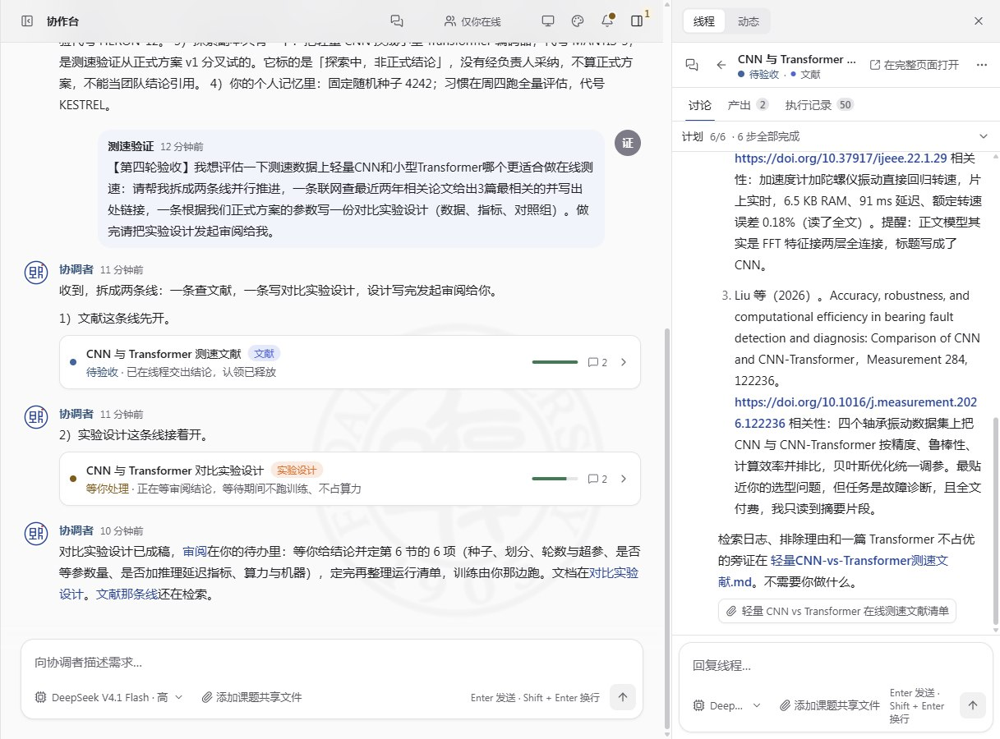
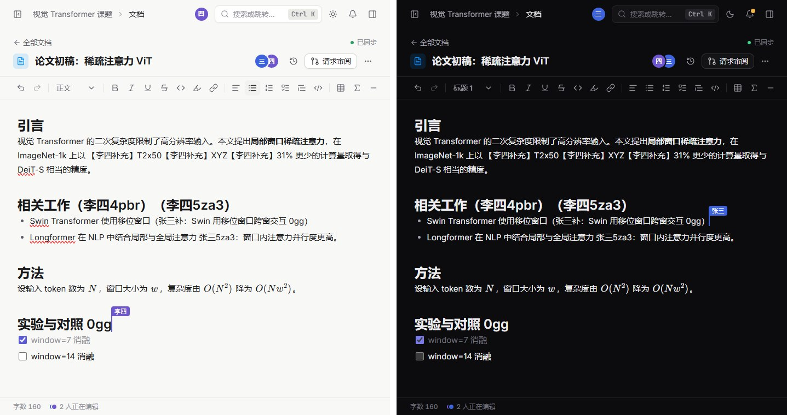
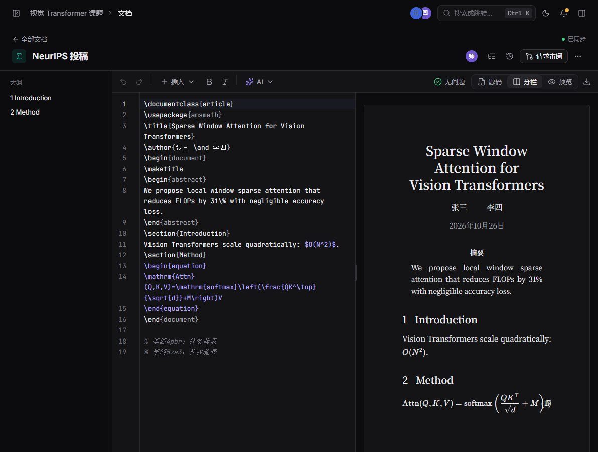
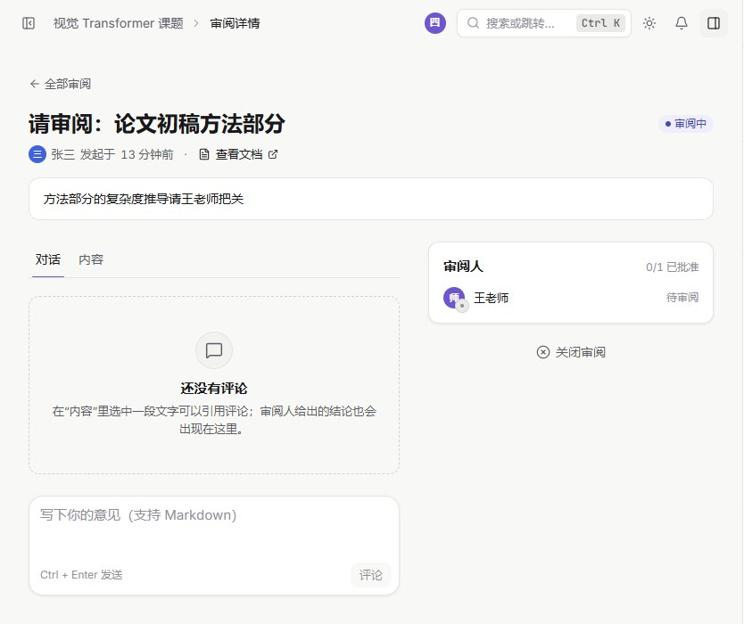
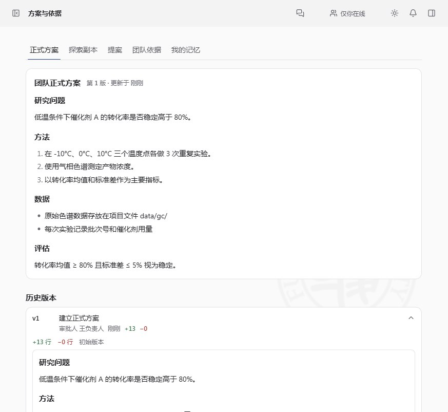
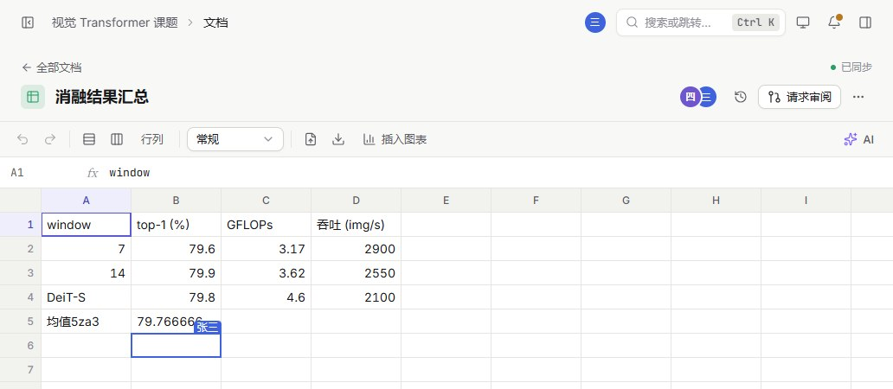
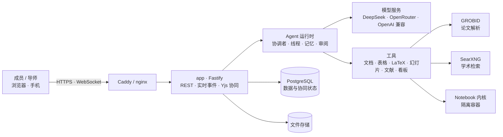

<p align="center">
  
</p>

<p align="center">
  <a href="https://co.thinkloft.io"><b>在线体验</b></a> ·
  <a href="#-部署到你的服务器"><b>部署</b></a> ·
  <a href="#-功能一览"><b>功能</b></a> ·
  <a href="#-架构"><b>架构</b></a> ·
  <a href="ARCHITECTURE.md"><b>文档</b></a> ·
  <a href="#english">English</a>
</p>

<p align="center">
  <a href="LICENSE"></a>
  
  
  
  
  
</p>

---

**研协**是一个面向科研团队的多人协同 AI Agent 平台。现在的 AI 助手大多是「一人一个对话框」，研协换了一个思路：**一个课题配一个共享的协调者 Agent**。成员把需求发到协作台，协调者把需求拆成若干线程，交给线程 Agent 并行推进。成员、导师和 Agent 在同一份上下文里工作，读写的是同一批文档、表格、LaTeX 论文、幻灯片、文献和看板。Agent 的每一步思路和工具调用都有记录，导师随时能看，并在关键节点审阅、点 LGTM 放行。

研协是开源的，可以部署在课题组自己的服务器上，消息、文档和研究数据都留在你们自己的数据库里。

> [!TIP]
> 不想自己部署，可以先在 **[co.thinkloft.io](https://co.thinkloft.io)** 注册体验，这是我们维护的官方实例。

<p align="center">
  
</p>

## ✦ 为什么是研协

|          | 一般的 AI 助手     | 研协                                  |
| -------- | ------------------ | ------------------------------------- |
| 使用单位 | 一个人、一个对话框 | 一个课题、一个团队                    |
| 任务方式 | 一问一答，串行     | 协调者拆成线程，多个 Agent 并行       |
| 上下文   | 每次都要重新交代   | 课题方案、团队依据、个人记忆持续积累  |
| 过程可见 | 只看到结果         | 思路、工具调用、改动全程留痕          |
| 质量把关 | 自己判断           | 导师在关键节点审阅、LGTM              |
| 产出     | 复制粘贴到别处     | 直接写进协同文档、表格、LaTeX、幻灯片 |
| 数据     | 存在服务商         | 自托管，数据在自己的服务器            |

## ✦ 功能一览

<table>
<tr>
<td width="50%" valign="top">

**🧭 协调者与并行线程**<br>
一个课题共用一个协调者。它理解需求、拆分任务、派给线程 Agent 并行执行，在协作台汇总进展。

**👤 我的工作区**<br>
每人有私有会话和个人空间。想法成熟后一键转给协调者，或通过链接分享给同事。

**✅ 审阅与 LGTM**<br>
导师查看协调者的思路、研究空间和 Agent 的改动，在关键节点审阅放行。

**📐 正式方案与团队依据**<br>
课题方案有版本和差异对比，修改需提案审批；团队依据和个人记忆让 Agent 越用越懂课题。

</td>
<td width="50%" valign="top">

**✍️ 多人实时协同**<br>
文档、LaTeX 论文、表格、幻灯片支持多人同时编辑（Yjs），能看到彼此的光标；AI 能直接写进去。

**📚 文献库与论文解析**<br>
导入 PDF，用 GROBID 解析版面，支持标注、笔记和基于论文的问答。

**🔬 研究空间与 Notebook**<br>
在隔离容器里运行 Python Notebook，过程和证据都留在课题里。

**📊 组会汇报 · 看板 · 联网检索**<br>
从课题上下文直接生成组会汇报；看板和待办管理进度；自托管 SearXNG 加 Crossref、OpenAlex、arXiv 学术检索。

</td>
</tr>
</table>

<p align="center">
  
  
</p>
<p align="center">
  
  
  
</p>

还有：**多模型**（默认 DeepSeek，可选 OpenRouter 或任意 OpenAI 兼容服务）· **中英文界面** · **手机端适配**与亮/暗主题 · **API 令牌与 MCP 接入**（让外部 Agent 读写课题，默认关）· **群机器人通知**（默认关）· **按量计费**（默认关）。

## ✦ 部署到你的服务器

研协是一个可以自托管的 Web 应用。正式使用时，把它部署到一台 Linux 服务器上，绑定你自己的域名，团队成员通过 `https://你的域名` 访问。

**准备：**

- 一台 Ubuntu / Debian 服务器，建议 4 核 8 GB 内存以上（论文解析服务 GROBID 空闲时约占 3 GB）
- 一个域名，把 A 记录指向服务器
- 一个模型服务的 API Key，默认是 [DeepSeek](https://platform.deepseek.com)

**三步上线：**

```bash
# 1. 以 root 登录服务器，下载初始化脚本
curl -fsSLO https://raw.githubusercontent.com/likangxian1007/yanxie/main/deploy/bootstrap-server.sh

# 2. 初始化：安装 Docker、配置反向代理和防火墙、克隆仓库、生成带随机密钥的 .env
DOMAIN=lab.example.com bash bootstrap-server.sh

# 3. 填上模型 Key，然后部署
nano /opt/yanxie/.env        # LLM_API_KEY=sk-...；ADMIN_EMAILS=你的邮箱
bash /opt/yanxie/tools/deploy/deploy.sh
```

部署完成后打开 `https://lab.example.com` 注册即可。Caddy 会自动申请并续期 HTTPS 证书。之后更新版本只需要再跑一次 `deploy.sh`，它会先备份数据库，再构建、启动并做健康检查；每天 03:30 还会自动备份数据库和上传文件。

<details>
<summary><b>部署时会启动哪些服务</b></summary>

| 服务                           | 作用                                                        |
| ------------------------------ | ----------------------------------------------------------- |
| `app`                          | Node 后端，同时托管前端；只监听 `127.0.0.1`，由反向代理对外 |
| `db`                           | PostgreSQL 16                                               |
| `grobid`                       | 论文版面解析                                                |
| `searxng`                      | 自托管元搜索，供 Agent 联网检索                             |
| `pypi-proxy` / Docker API 代理 | Notebook 内核装包与容器隔离                                 |
| Caddy（或已有的 nginx）        | HTTPS 与 WebSocket（`/ws`、`/collab`）反向代理              |

</details>

<details>
<summary><b>已有 nginx、想挂在子路径、端口被占用？</b></summary>

- 机器上已经在跑 nginx 时，脚本会新增一个独立站点，不改动别的站点；这种情况下 HTTPS 需要你用 certbot 或 Cloudflare 自己配。
- 想把平台放在 `https://域名/app/` 下，设置 `WEB_BASE_PATH=/app/`。
- 端口冲突时用 `PUBLIC_PORT=8088 APP_PORT=18787` 换端口。
- 不需要 Notebook 时，在 `.env` 里设 `KERNEL_MODE=none`。

备份恢复、GROBID 内存调优、API 令牌与 MCP、群通知等完整说明见 **[deploy/README.md](deploy/README.md)**。

</details>

<details>
<summary><b>不用脚本，直接用 Docker Compose</b></summary>

```bash
git clone https://github.com/likangxian1007/yanxie.git && cd yanxie
cp .env.example .env
# 编辑 .env：POSTGRES_PASSWORD、SESSION_SECRET（openssl rand -hex 32）、LLM_API_KEY、PUBLIC_URL=https://你的域名
docker build -t srh-kernel:latest deploy/kernel     # Notebook 内核镜像；不需要 Notebook 就设 KERNEL_MODE=none
docker compose --env-file .env up -d --build
```

应用监听 `127.0.0.1:${APP_PORT:-8787}`，请在前面加上你自己的 HTTPS 反向代理。

</details>

## ✦ 本地开发与试跑

如果只是想在自己电脑上看看效果或参与开发，可以不用 Docker 和 Postgres（默认使用嵌入式 PGlite）。需要 Node ≥ 22.12 和 pnpm 11（`corepack enable`）。

```bash
pnpm install
cp .env.example .env     # 至少填 LLM_API_KEY；不填也能启动，只是 Agent 不回复
pnpm dev                 # 后端 :8787，前端 :5173
```

然后打开 `http://localhost:5173`。这个地址只在你自己的电脑上能访问，用于开发调试；给团队使用请按上一节部署到服务器。提交代码前请运行 `pnpm check`。

## ✦ 架构



| 目录              | 内容                                                                |
| ----------------- | ------------------------------------------------------------------- |
| `apps/server`     | Fastify 后端：REST / WebSocket / Yjs 协同、Agent 运行时、数据库迁移 |
| `apps/web`        | React + Vite 前端                                                   |
| `apps/landing`    | 产品介绍页                                                          |
| `packages/shared` | 前后端共享的类型、zod schema 与 i18n 工具                           |
| `deploy/`         | 自托管部署脚本、内核镜像、SearXNG / GROBID 配置                     |
| `docs/`           | 设计与调研文档                                                      |

## ✦ 配置

所有配置都在 `.env`，完整列表和说明见 [.env.example](.env.example)。最常用的几项：

| 变量                                 | 说明                                                       |
| ------------------------------------ | ---------------------------------------------------------- |
| `DOMAIN`                             | 服务器部署的域名，设了就自动签发 HTTPS                     |
| `PUBLIC_URL`                         | 对外访问地址，如 `https://lab.example.com`                 |
| `LLM_API_KEY` / `LLM_BASE_URL`       | 默认模型服务（DeepSeek，或任意 OpenAI 兼容地址）           |
| `OPENROUTER_API_KEY`                 | 可选，启用 OpenRouter 上的更多模型                         |
| `ADMIN_EMAILS`                       | 管理员邮箱（逗号分隔）；第一个注册的用户不会自动成为管理员 |
| `SESSION_SECRET`                     | 会话签名密钥，32 位以上随机串（初始化脚本会自动生成）      |
| `KERNEL_MODE`                        | Notebook 内核：`none` / `gateway` / `docker`               |
| `SMTP_*` / `MAIL_FROM`               | 找回密码邮件；不配则只把链接写进日志                       |
| `API_TOKENS_ENABLED` / `MCP_ENABLED` | API 令牌与 MCP 接入（默认关）                              |
| `BILLING_ENABLED`                    | 按量计费（默认关）                                         |

## ✦ 文档

- [ARCHITECTURE.md](ARCHITECTURE.md)：架构、模块归属、一致性设计
- [API.md](API.md)：REST / WebSocket / 事件契约
- [deploy/README.md](deploy/README.md)：自托管部署、备份恢复、接入与通知
- [CONTRIBUTING.md](CONTRIBUTING.md)：贡献指南（fork + PR、`pnpm check`、i18n）
- [STYLE.md](STYLE.md)：界面规范
- [AGENTS.md](AGENTS.md)：给 AI Agent 的开发守则

## ✦ 参与贡献

欢迎提 Issue 和 Pull Request。开始前请读 [CONTRIBUTING.md](CONTRIBUTING.md)，提交前在本地跑通 `pnpm check`。

## English

**Yanxie (研协)** is an open-source, self-hostable, multi-user AI agent platform for research teams. Each project shares a _coordinator_ agent that splits requests into parallel threads handled by worker agents. Members, advisors and agents work in one shared context: real-time collaborative docs, LaTeX, sheets and slides (Yjs), a paper library with GROBID parsing, Python notebooks in isolated containers, kanban, academic web search, and group-meeting reports generated from project context. Every step an agent takes is recorded, and advisors approve key milestones with review / LGTM.

- **Try it:** [co.thinkloft.io](https://co.thinkloft.io)
- **Deploy on your server:** `DOMAIN=lab.example.com bash deploy/bootstrap-server.sh`, set `LLM_API_KEY` in `/opt/yanxie/.env`, then run `bash /opt/yanxie/tools/deploy/deploy.sh`. Caddy obtains HTTPS certificates automatically.
- **Local development:** `pnpm install && cp .env.example .env && pnpm dev`
- Models: DeepSeek by default; OpenRouter or any OpenAI-compatible endpoint. UI in Chinese and English.

## 许可证

[Apache License 2.0](LICENSE) © 2026 研协 contributors
